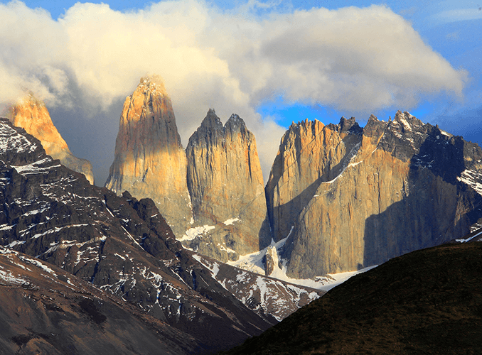
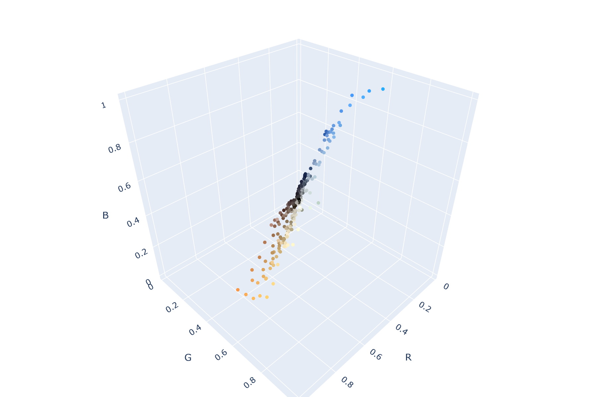
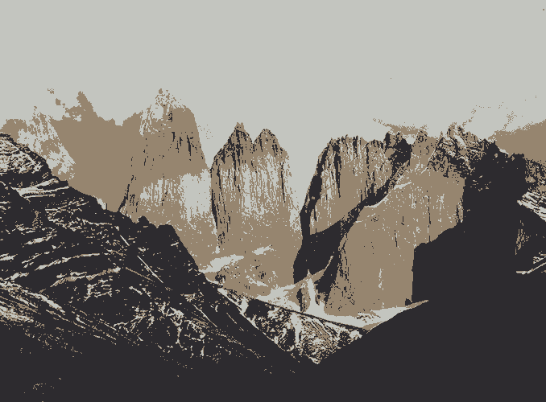
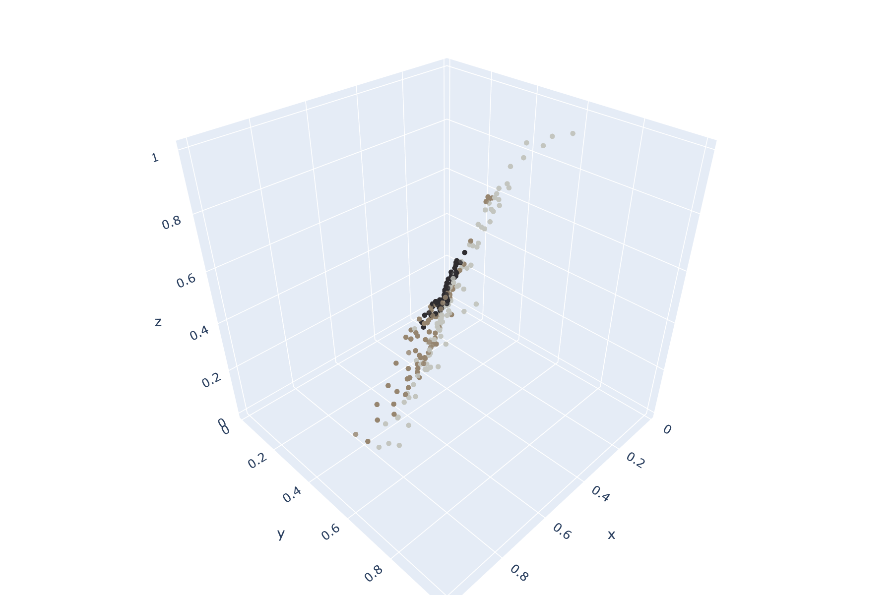
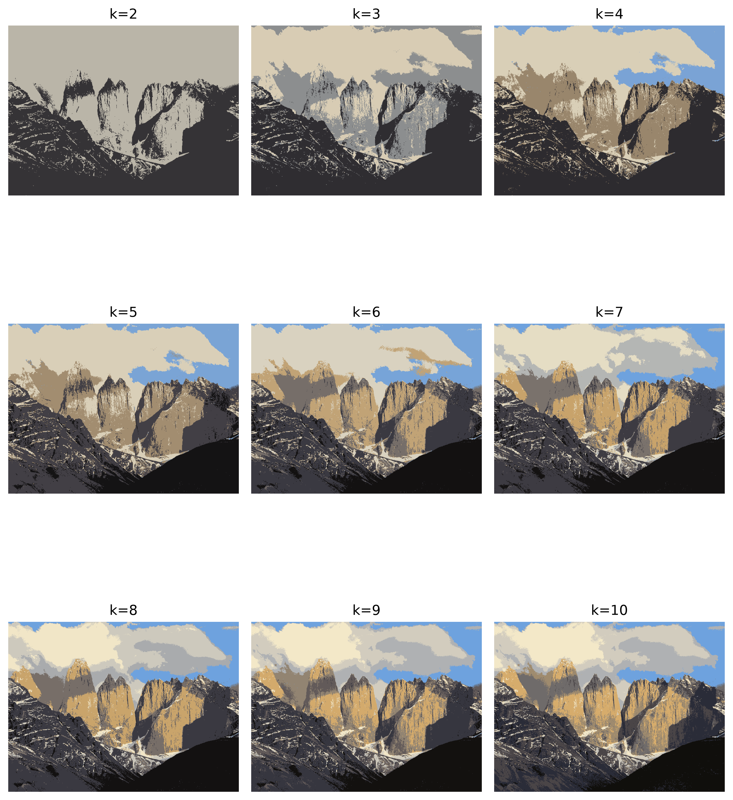

# Image Color Quantization with K-Means Clustering

Unsupervised machine learning project applying **K-Means clustering** to analyze the 3D RGB color space and compress the color palette of a photograph of **Torres del Paine**.

### 1. Original Photograph & RGB Color Space
Using a sample of 5,000 pixels, we project the image into a 3D RGB cube to observe its color "fingerprint". Instead of random scattering, pixels naturally form well-defined clusters (sky/lake blues, rocky grays/browns, and bright whites for snow), visually justifying why **K-Means** can summarize the image into a few key colors.

| Original Image | 3D RGB Color Distribution |
| :---: | :---: |
|  |  |

### 2. Single Centroid Approximation ($k = 1$)
When fitting K-Means with $k = 1$, every pixel is replaced by the single global centroid—which matches the mathematical mean of the R, G, and B channels, resulting in a uniform neutral gray tone.

### 3. Three-Color Segmentation ($k = 3$)
Increasing the model to $k = 3$ separates the photograph into its three dominant visual components. Re-plotting the 3D space with centroid colors shows how K-Means partitions the pixel clouds spatially.

| Quantized Image ($k = 3$) | Clustered 3D RGB Space ($k = 3$) |
| :---: | :---: |
|  |  |

### 4. Multi-Cluster Comparison ($k = 2$ to $k = 10$)
Finally, we evaluate how image detail and color fidelity progressively recover as we increase the number of clusters from $k = 2$ up to $k = 10$.

